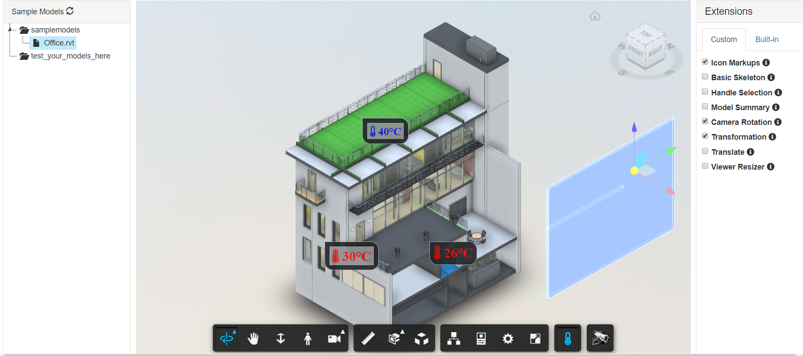

# aps-extensions

# Description

This sample is a collection of extensions ready to be reused. Just add reference to the required files, load and use. Check each extension documentation for details.

1. [Camera Rotation](public/extensions/CameraRotation)
2. [Icon Markup](public/extensions/IconMarkupExtension)
3. [Nested Viewer](public/extensions/NestedViewerExtension)
4. [Transform](public/extensions/TransformationExtension)
5. [GoogleMapsLocator](public/extensions/GoogleMapsLocator)
6. [Draw Tool Extension](public/extensions/DrawToolExtension)
7. [Custom Properties Extension](public/extensions/CustomPropertiesExtension)
8. [XLS Extension](public/extensions/XLSExtension)
8. [Edit2D Extension](public/extensions/Edit2dExtension)
9. [Phasing Extension](public/extensions/PhasingExtension)

Extensions were created using a [Basic Skeleton](public/extensions/_BasicSkeleton).

This sample is based on the [Learn APS](http://learnforge.autodesk.io) tutorials in the section *View modelss*.

## Thumbnail

## Live Demo

Extensions are dynamically loaded and unloaded for testing on the live version.

[aps-extensions.autodesk.io](https://aps-extensions.autodesk.io)

# Setup

To use this sample, you will need Autodesk developer credentials. Visit the [APS Developer Portal](https://developer.autodesk.com), sign up for an account, then [create an app](https://developer.autodesk.com/myapps/create). For this new app, use `http://localhost:3000/api/aps/callback/oauth` as the Callback URL, although it is not used on a 2-legged flow. Finally, take note of the **Client ID** and **Client Secret**.

## Run locally

Install [NodeJS](https://nodejs.org).

Clone this project or download it. It's recommended to install [GitHub Desktop](https://desktop.github.com/). To clone it via command line, use the following (**Terminal** on MacOSX/Linux, **Git Shell** on Windows):

    git clone https://github.com/autodesk-platform-services/aps-extensions.git

To run it, install the required packages, set the enviroment variables with your client ID & Secret and finally start it. Via command line, navigate to the folder where this repository was cloned to and use the following commands:

Mac OSX/Linux (Terminal)

    npm install
    export APS_CLIENT_ID=<<YOUR CLIENT ID FROM DEVELOPER PORTAL>>
    export APS_CLIENT_SECRET=<<YOUR CLIENT SECRET>>
    export APS_BUCKET=<<KEY OF THE OSS BUCKET WITH YOUR TRANSLATED DESIGNS>>
    npm start

Windows (use **Node.js command line** from the Start menu)

    npm install
    set APS_CLIENT_ID=<<YOUR CLIENT ID FROM DEVELOPER PORTAL>>
    set APS_CLIENT_SECRET=<<YOUR CLIENT SECRET>>
    set APS_BUCKET=<<KEY OF THE OSS BUCKET WITH YOUR TRANSLATED DESIGNS>>
    npm start

Alternatively, put the variables in a `.env` file in the project folder. `npm start` loads it automatically if it exists (requires Node.js 22.9 or later).

The app does not upload files. Upload and translate your test designs into the `APS_BUCKET` bucket separately, and they will be listed in the app.

Open the browser: [http://localhost:3000](http://localhost:3000).

### Viewer version

The app uses the Viewer v8 preview. Viewer v8 requires a secure context: HTTPS, or `http://localhost`. It won't run from a LAN IP address over plain HTTP. The viewer files are included in [public/index.html](public/index.html), and the viewer is initialized with `env: 'AutodeskProduction2'` and `api: 'streamingV2'` in [public/js/viewer.js](public/js/viewer.js). With the legacy `env: 'AutodeskProduction'`, moving model elements (as the Transformation extension does) breaks the viewer's bounding box calculations in the v8 preview.

The Potree Point Clouds extension is disabled for now. It relies on three.js rendering, which Viewer v8 doesn't expose.

# Adding a new extension

See [CONTRIBUTING.md](CONTRIBUTING.md).

# Understanding extensionloader and using it in aps app

The way loose coupling between extensions and aps app is achived is with custom event, if you want to use extensionloader in your aps app, follow the three steps:

1) Copy paste the [extensions](https://github.com/autodesk-platform-services/aps-extensions/tree/main/public/extensions) in public folder of your app or in the folder where the index file resides. 

2) Include below script in index.html file
<pre>

</pre>

3) Here's the linking part between the app and the extensionloader, in viewer [onDocumentLoadSuccess](https://github.com/autodesk-platform-services/aps-extensions/blob/main/public/js/viewer.js#L35) function, emit an event to inform the extensionloader that viewer has loaded the model with the below [code](https://github.com/autodesk-platform-services/aps-extensions/blob/main/public/js/viewer.js#L39):
<pre>
var ViewerInstance = new CustomEvent("viewerinstance", {detail: {viewer: viewer}});      
document.dispatchEvent(ViewerInstance);
</pre>
 To load an extension programmatically, emit the below event.
 <pre>
 var LoadExtensionEvent = new CustomEvent("loadextension", {
              detail: {
                extension: "Extension1",
                viewer: viewer
             }
         });
 document.dispatchEvent(LoadExtensionEvent);
 </pre>

To unload extension:
<pre>
 var UnloadExtensionEvent = new CustomEvent("unloadextension", {
              detail: {
                extension: "Extension1",
                viewer: viewer
             }
         });
 document.dispatchEvent(UnloadExtensionEvent);
</pre>
>Note: If the extension needs additional UI elements, first option we suggest is use the viewer UI [Autodesk.Viewing.UI.DockingPanel](https://forge.autodesk.com/en/docs/viewer/v2/reference/javascript/dockingpanel)

## Packages used

The [Autodesk Platform Services](https://www.npmjs.com/package/forge-apis) packages are included by default. Some other non-Autodesk packages are used, including [express](https://www.npmjs.com/package/express) and [multer](https://www.npmjs.com/package/multer) for upload.

# Tips & tricks

For local development/ testing, consider using the [nodemon](https://www.npmjs.com/package/nodemon) package, which auto-restarts your node application after any modification to your code. To install it, use:

    sudo npm install -g nodemon

Then, instead of **npm run dev**, use the following:

    npm run nodemon

Which executes **nodemon server.js --ignore www/**, where the **--ignore** parameter indicates that the app should not restart if files under the **www** folder are modified.

## Troubleshooting

After installing GitHub Desktop for Windows, on the Git Shell, if you see the ***error setting certificate verify locations*** error, then use the following command:

    git config --global http.sslverify "false"

# License

This sample is licensed under the terms of the [MIT License](http://opensource.org/licenses/MIT).
Please see the [LICENSE](LICENSE) file for full details.

## Written by

The [APS Advocates](http://forge.autodesk.com) team:

* Varun Patil [@VarunPatil578](https://twitter.com/VarunPatil578)
* Petr Broz [@ipetrbroz](https://twitter.com/ipetrbroz)
* Augusto Goncalves [@augustomaia](https://twitter.com/augustomaia)
