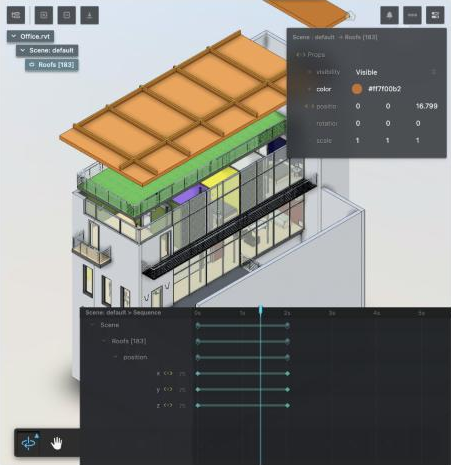

# Animation editor

[Demo](https://aps-extensions.autodesk.io/?extension=AnimationEditor)

Animate model elements on a timeline with keyframes and curves. The animation is applied to the model through the [Scene API](https://aps.autodesk.com/blog/aps-viewer-v8-preview-here) of Viewer v8, and can be downloaded and replayed with the [Animation player](../AnimationPlayer) extension.

The editor is the studio of [Theatre.js](https://github.com/theatre-js/theatre), an open source animation library. The player only needs the much smaller Theatre.js core.



## Usage

1. Enable the extension. The editor opens over the viewer. The film button in the viewer toolbar shows or hides it.
2. Select one or more elements in the viewer, and click **Animate the elements selected in the viewer** (the square with a plus sign) in the editor toolbar at the top left. Each element becomes an object in the outline, named `<element name> [<dbId>]`.
3. Select the object in the outline (or click the element in the viewer) to edit its props on the right:

   | Prop | Description |
   | --- | --- |
   | `visibility` | Visible, ghosted or hidden |
   | `color` | Theming color; the alpha channel is the intensity (0 = no theming) |
   | `position` | Offset from the element's original position, in model units |
   | `rotation` | Rotation in degrees around the center of the element's bounding box, applied in X, Y, Z order |
   | `scale` | Scale around the center of the element's bounding box |

4. To animate a prop, right-click it and choose **Sequence**. Move the playhead in the sequence editor and change the value to add keyframes. See the [Theatre.js documentation](https://www.theatrejs.com/docs/latest/manual/sequences) for more details.
5. Click **Download the animation for the player extension** (the arrow) in the editor toolbar to save the animation as an `.animation.json` file.

To stop animating elements, select them in the viewer and click **Stop animating the elements selected in the viewer** (the square with a minus sign). This also deletes their keyframes.

The editor keeps your work in the browser's local storage, so it's still there when you reload the page. There's one animation project per model, named after the design file. Set the `projectId` option to use another name (3 to 32 characters).

Elements inside another animated element in the object tree (for example, a family instance inside an animated family type) follow that parent element, and can be animated on top of it.

## Setup

Include the shared `SceneAnimator.js` from the player extension and this extension's `main.js` on your page. The extension loads [Theatre.js](https://www.jsdelivr.com/package/npm/@theatre/browser-bundles) (the core and studio bundle) from a CDN when it's first loaded. It uses the Scene API, so it requires Viewer v8 (or v7 with the Scene API enabled).

```xml
<script src="extensions/AnimationPlayer/contents/SceneAnimator.js"></script>
<script src="extensions/AnimationEditor/contents/main.js"></script>
```

After the model is loaded, load the extension:

```javascript
viewer.loadExtension('AnimationEditor', { projectId: 'My animation' /* optional */ });
```

## How it works

Theatre.js refuses to load a second copy of its core on a page, so the two extensions share what's already loaded. When the editor is loaded first, the player uses the core from the editor's core and studio bundle. When the player is loaded first, the editor still loads the core and studio bundle, and lets it register its own core next to the player's; the player keeps using its own.

Each animated element is a Theatre.js sheet object, with props for position, rotation, scale, visibility and color. Its key ends with the element's dbId in square brackets, which is how the player finds the element again. The downloaded file is a Theatre.js project state.

When the values change, `SceneAnimator` (shared with the player) updates the element's instances through `model.getInstances()`, an `Autodesk.Viewing.Scene.InstanceCollection3D`:

- `setTransformWorld` sets each instance's transform from its original transform, the element's rotation and scale around its center, and its offset (combined with the transforms of animated parent elements).
- `setVisibilityState` shows, ghosts or hides the instances.
- `setThemingColor` sets the theming color of the instances' dbIds.

The instance collection is switched to `UsageHint.Dynamic` while the extension is loaded. Unloading the extension puts all elements back as they were.

The Theatre.js studio normally covers the whole browser window. The extension fits it to the viewer instead: it sizes the studio's root element to the viewer's container and makes it the containing block of the studio's panels, and keeps it in place when the page is resized or scrolled. The layer that holds the studio's menus and tooltips is moved back to cover the window, as they're positioned from mouse coordinates.

## Limitations

- The Theatre.js studio logs `ReferenceError: process is not defined` when it starts (from its update check in the browser bundle). It doesn't affect the extension.
- In the Viewer v8 preview, moving the instances of some models (for example `xArm.f3d` in the sample bucket) makes the viewer stop rendering with `TypeError: e.makeEmpty is not a function`. This also happens with the `Node3D` scene graph, so it's not specific to this extension.
