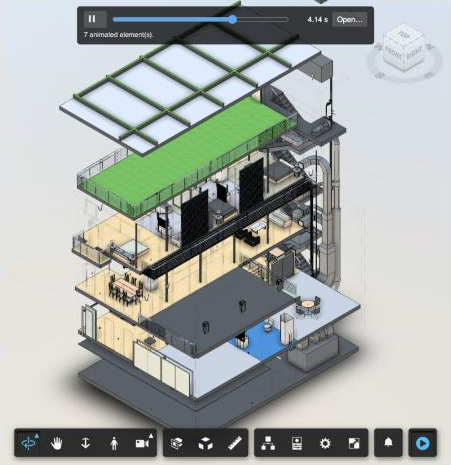

# Animation player

[Demo](https://aps-extensions.autodesk.io/?extension=AnimationPlayer)

Plays animations made with the [Animation editor](../AnimationEditor) extension. It uses the [Scene API](https://aps.autodesk.com/blog/aps-viewer-v8-preview-here) of Viewer v8 to move, rotate, scale, hide, ghost and color model elements, and the lightweight core of [Theatre.js](https://github.com/theatre-js/theatre) (about 100 KB, without the editor) to play the animation.



## Usage

Enable the extension. A player bar appears at the top of the viewer, with play/pause, a position slider and an **Open…** button. Open an animation file (`.animation.json`, downloaded from the editor), or drop one on the viewer. The play button in the viewer toolbar shows or hides the player bar.

The extension comes with a sample animation for `Office.rvt` ([samples/Office.json](samples/Office.json)), which plays when you enable the extension on that model. Animated elements that aren't in the loaded model are skipped, and the player bar says how many there were.

## Options

| Option | Default | Description |
| --- | --- | --- |
| `animationUrl` | the `Office.rvt` sample | URL of an animation file to load when the extension is loaded. Empty for none |
| `autoplay` | `true` | Start playing as soon as an animation is loaded |
| `loop` | `true` | Play the animation in a loop |

## Setup

Include `SceneAnimator.js` and this extension's files on your page. The extension loads the Theatre.js core from a CDN when it's first loaded, unless Theatre.js is already on the page. It uses the Scene API, so it requires Viewer v8 (or v7 with the Scene API enabled).

```xml
<link rel="stylesheet" href="extensions/AnimationPlayer/contents/main.css">
<script src="extensions/AnimationPlayer/contents/SceneAnimator.js"></script>
<script src="extensions/AnimationPlayer/contents/main.js"></script>
```

After the model is loaded, load the extension, and play an animation:

```javascript
const player = await viewer.loadExtension('AnimationPlayer', { animationUrl: 'animations/my-animation.json', loop: false });
// Or load an animation (a Theatre.js project state object) yourself
player.loadAnimation(state);
player.play();
player.pause();
```

## How it works

An animation file is a [Theatre.js project state](https://www.theatrejs.com/docs/latest/manual/projects#state). The player creates a Theatre.js project from it, and a sheet object for each animated element, with the same props as the editor. The dbId at the end of each object key (`<element name> [<dbId>]`) identifies the element, and the name must match the element's name in the model.

`SceneAnimator.js` applies the animated values with the Scene API's `InstanceCollection3D` (`setTransformWorld`, `setVisibilityState` and `setThemingColor`). See the [editor extension](../AnimationEditor#how-it-works) for details. Unloading the extension, or loading another animation, puts all elements back as they were.

## Limitations

- Theatre.js can only be loaded once per page. If the editor extension is loaded first, the player uses its Theatre.js core. The editor can't be loaded after the player until the page is reloaded.
- In the Viewer v8 preview, moving the instances of some models (for example `xArm.f3d` in the sample bucket) makes the viewer stop rendering with `TypeError: e.makeEmpty is not a function`.
